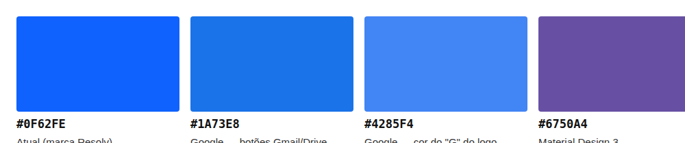
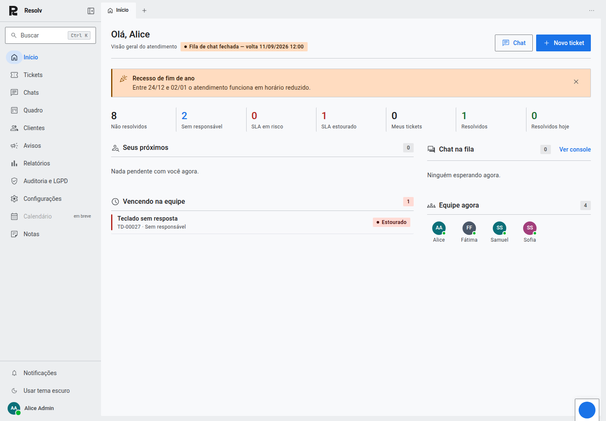
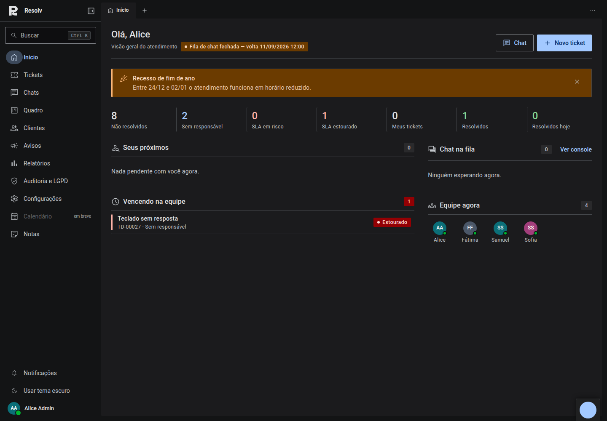
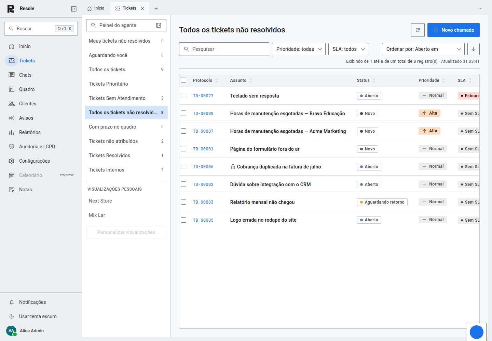

# A marca troca de azul: #0F62FE → #1A73E8 (azul de botão do Google)

Resposta a "os botões ainda parecem estar na cor que não é do Google" —
depois de conferir que o botão já renderizava exatamente o valor do token
(sem bug), ficou claro que a questão era outra: `#0F62FE` nunca foi um azul
do Google. Era o Carbon Blue da IBM, e já era a cor de marca do Resolv antes
de qualquer trabalho de Material 3 — só puxava mais pro índigo/escuro do que
o azul que aparece em Gmail, Drive e Documentos.

Perguntei diretamente: manter a marca atual, trocar para o azul de produto
do Google, ou um meio-termo. A resposta foi **trocar para `#1A73E8`** — o
mesmo azul do botão "Escrever" do Gmail.

## O que mudou

Como o M3 deriva TODOS os papéis de cor (container, on-color, tema escuro,
hover) do mesmo matiz da âncora, a troca não foi um find-and-replace de um
hex — foi recalcular a rampa tonal inteira:

- **Matiz**: 262° → 257,9° (em OKLCH, a partir do novo hex)
- **Croma**: 0,243 → 0,195 (o azul do Google é um pouco menos saturado)
- **L\***: 47 → 50

As cinco famílias derivadas do matiz da marca foram regeneradas:
`primary`, `secondary` (mesmo matiz, croma baixa), `tertiary` (matiz +60°),
`neutral` e `neutral-variant` (croma quase zero, mas seguem o mesmo matiz de
propósito). `error`, `success` e `warning` não mudam — são âncoras
independentes da marca.

Contraste conferido de novo com o novo valor: branco sobre `#1A73E8` dá
4,51:1 (passa AA), meio ponto abaixo do azul anterior (5,05:1) mas ainda
dentro da margem.

## Onde a mudança entra

`styles/md3.css` é a fonte única — `--md-primary` (claro) e as rampas
`--md-ref-primary/secondary/tertiary/neutral/nv-*`. Como o resto da base
resolve cor através desses papéis (nunca um hex cru), a troca chegou sozinha
a: botões, links, foco, cápsula de navegação ativa, tingimento de elevação,
badges de marca, chips selecionados — sem editar um componente sequer.

`cvz/styles/_theme.scss` (o admin, produto separado com seu próprio design
system) **não foi tocado** — fica fora do escopo desta rodada, de propósito.

## Telas com o novo azul

