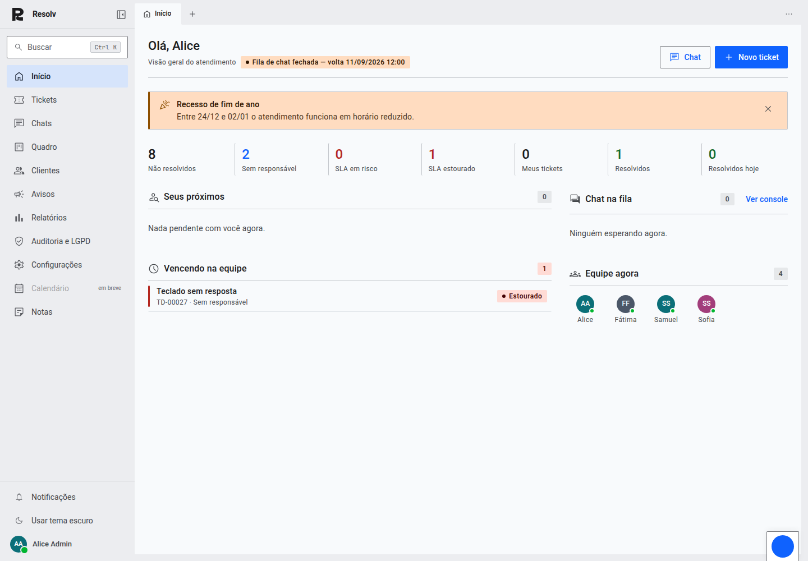
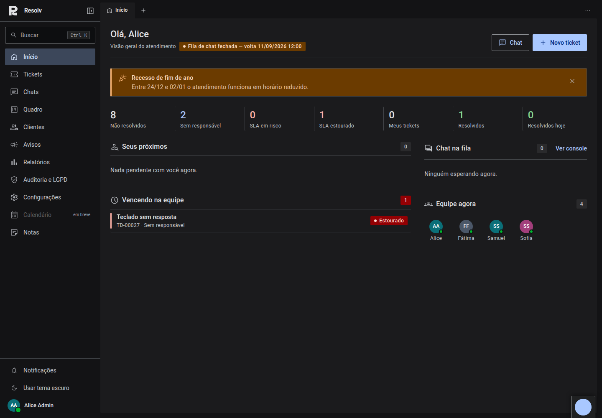
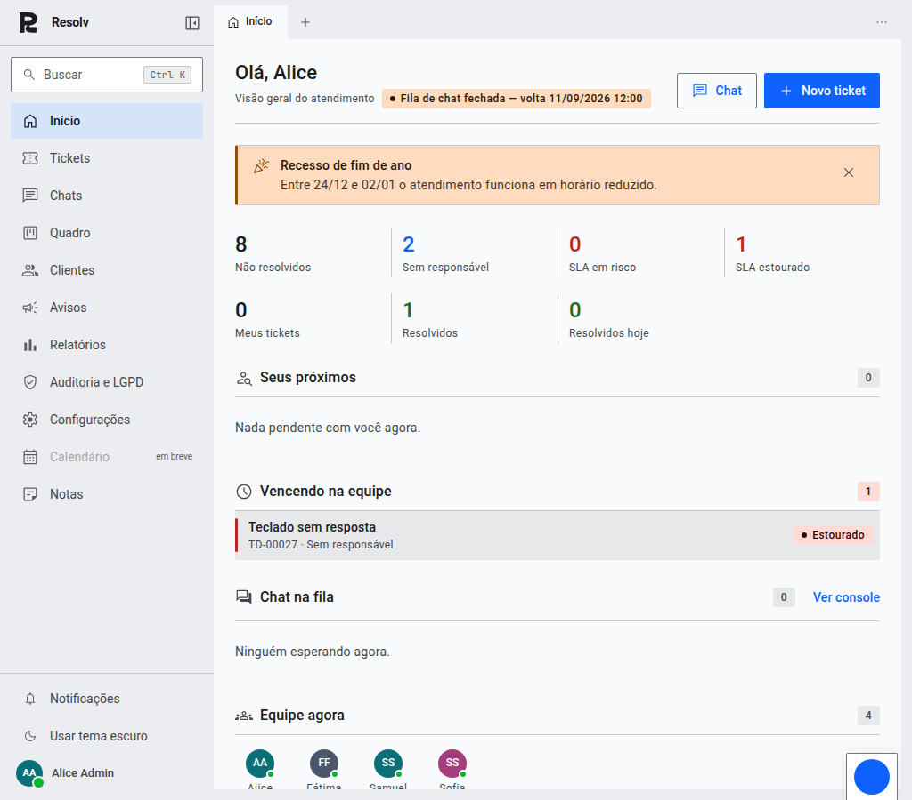
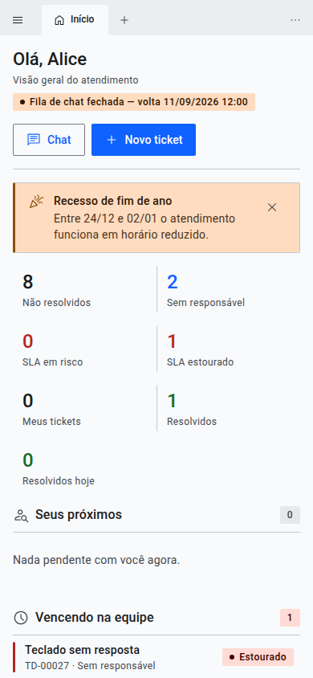
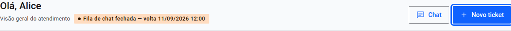
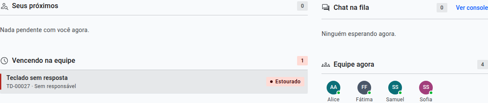

# Início em Material Design 3 — prints da tela 1 de 4

Prints da página inicial do console do agente depois da troca da base visual
para o Material Design 3 (Material You), na versão compacta e corporativa.
Commit da tela: `a27d0db`.

As três regras do projeto valem sobre o padrão do M3 sempre que os dois
discordam, e estão declaradas como token em `frontend/src/styles/md3.css`:

| Eixo        | Token                              | Valor          |
|-------------|------------------------------------|----------------|
| Forma       | `--radius-default`                 | 2px            |
| Altura      | `--control-height-sm` / `md` / `lg`| 36 / 40 / 44px |
| Tipografia  | title-large / headline-small       | 22 / 24px      |

## Desktop — 1440 × 1000

Cabeçalho com uma única ação principal (Filled Button) e a de apoio em
Outlined; banner de aviso; faixa de indicadores em sete colunas com divisor
entre elas; duas colunas de trabalho com pesos diferentes.

## Tema escuro — 1440 × 1000

Os mesmos papéis do M3, outros tons. O cromo é `surface`, o painel é
`surface-container-low` e o cartão é `surface-container` — no escuro quem
sobe na hierarquia clareia, e é isso que separa os níveis sem sombra nenhuma.

## Tablet — 1024 × 900

A faixa de indicadores passa a quatro colunas e a grade de trabalho vira
coluna única, na mesma ordem de leitura. Não é o desktop comprimido: a
contagem de colunas muda.

## Celular — 390 × 844

Duas colunas de indicadores, cabeçalho empilhado, ações lado a lado. Os
divisores continuam caindo entre colunas porque a grade tem contagem fixa por
faixa de tela.

## Foco por teclado

O anel do M3: 3px na cor primária, deslocado 2px. É o deslocamento que o
mantém visível *em cima* do próprio botão azul — o vão mostra a superfície.

## State layer

No M3 o estado não troca a cor do componente: acrescenta uma camada da cor de
conteúdo dele a 8% (hover) ou 10% (pressed). A mesma regra serve em botão
azul, linha branca e item de menu escuro.

## A paleta

Gerada no espírito do HCT — o espaço de cor do M3: tom é o L\* do CIELAB,
matiz e croma ficam constantes e o que não cabe no sRGB perde croma até caber
(`frontend/scripts/` e o cabeçalho de `md3.css` documentam o método). A âncora
é o azul que o sistema já usava.

| Papel               | Claro     | Observação                                                        |
|---------------------|-----------|-------------------------------------------------------------------|
| `primary`           | `#0f62fe` | o azul que o sistema já usava — L\* 47, é ele o `primary` do claro |
| `primary-container` | `#d4e4ff` | tom 90 da mesma rampa                                             |
| `surface`           | `#f8fafc` | tom 98 do neutro, com croma quase zero de propósito                |
| `surface-container` | `#ecedf0` | o cromo: sidebar e barra de abas                                  |
| `outline-variant`   | `#dfe3e8` | o divisor padrão — a linha que separa, no lugar da sombra          |
| `error`             | `#b4271f` | o único papel semântico que o M3 traz pronto                      |
| `success`           | `#146c2e` | extensão declarada: a fila precisa dizer "no prazo"               |
| `warning`           | `#8d4f00` | extensão declarada: e precisa dizer "em risco"                    |

Ícones: Material Symbols (Outlined, peso 400) — os 83 em uso embutidos como
`path` em `frontend/src/resolv/shell/simbolos.ts`, sem fonte de 4 MB, sem CDN
e sem dependência em runtime. Fonte: Roboto, empacotada.
