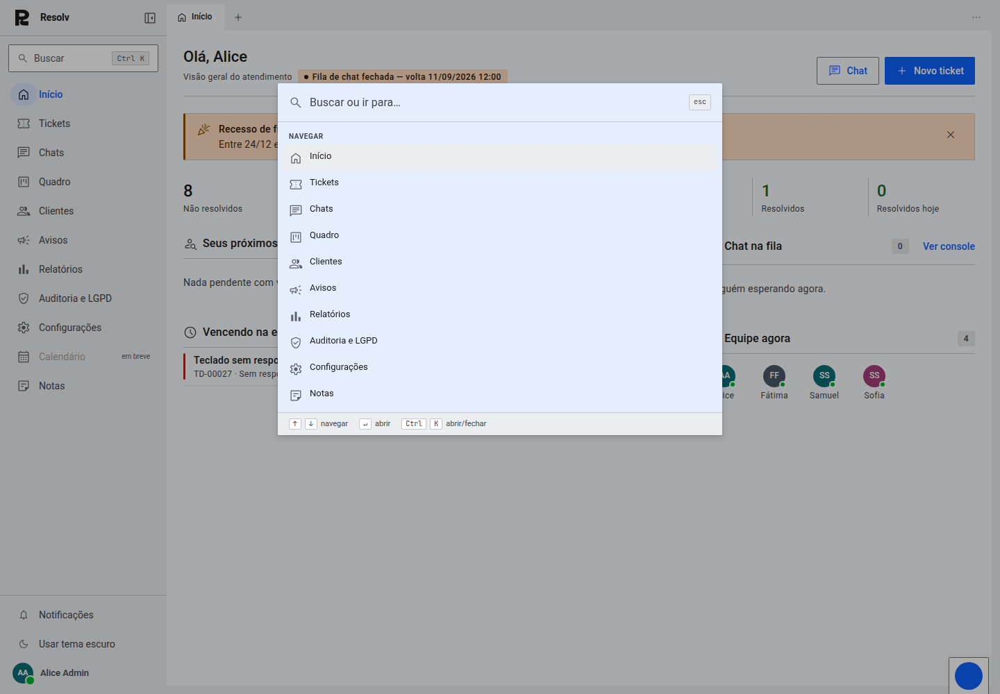
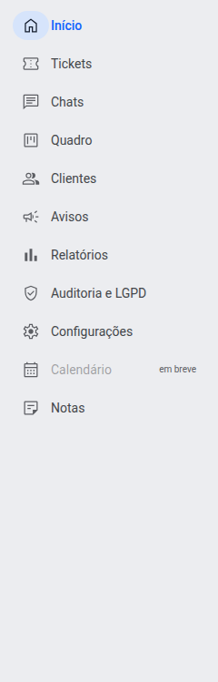
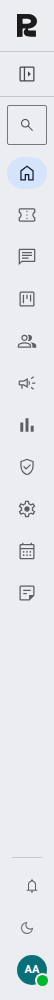
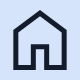
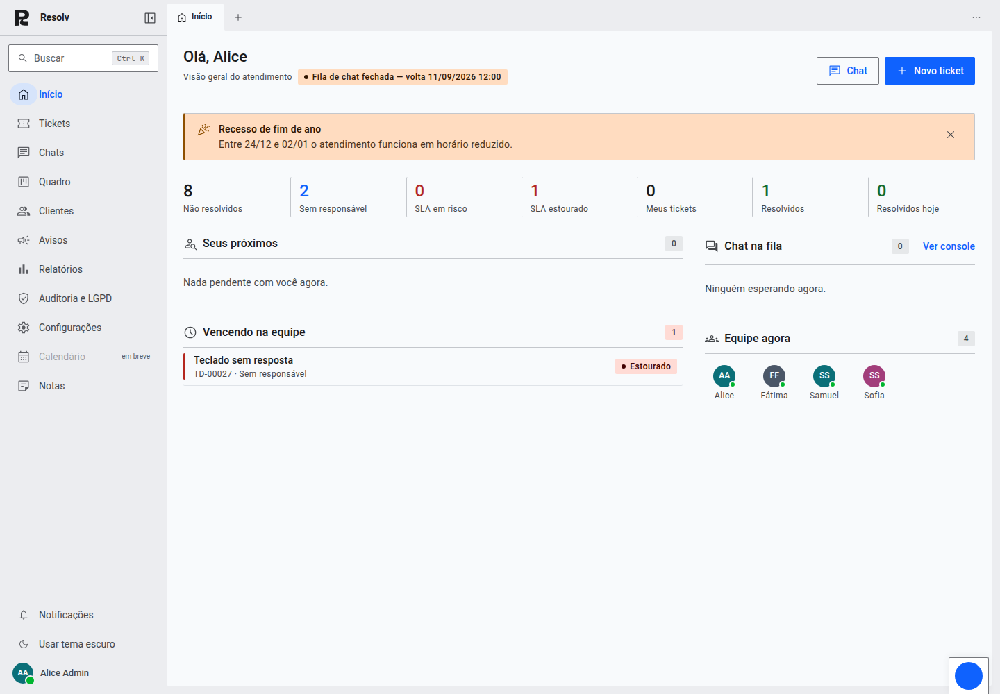
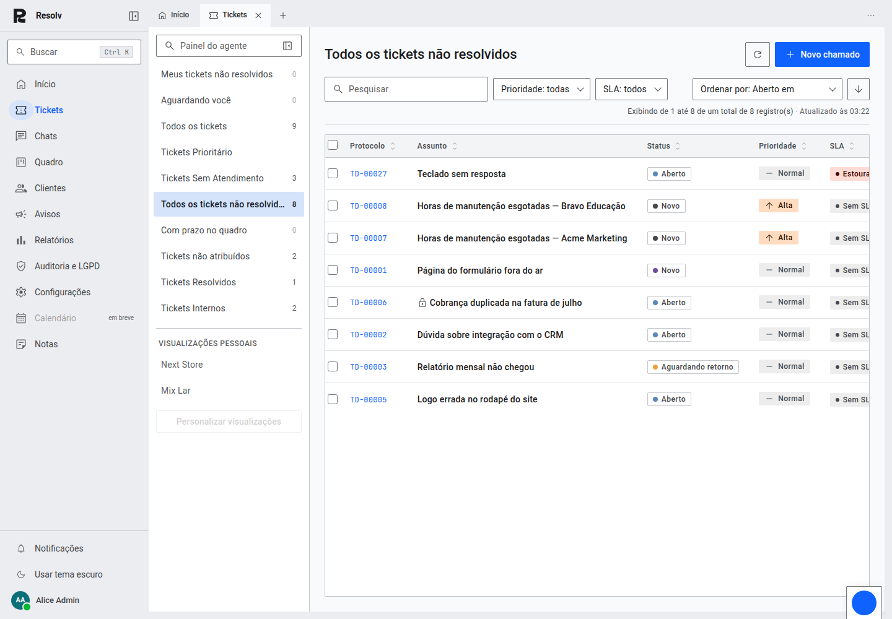

# Reforço de assinatura visual do Material 3

Resposta a uma pergunta direta: "por que isso não se parece com o Material
Design do Google, mesmo dizendo que usa Material 3?"

A resposta honesta é que o que mais faz alguém reconhecer Material Design de
relance é **forma** — cantos bem arredondados, botões e chips em pílula, FAB —
e o briefing original pediu para tirar exatamente esses traços (raio de 2px,
sem pílula, compacto e corporativo). O que sobrou por baixo é a arquitetura
real do M3 (papéis de cor via HCT, escala tipográfica, elevação, state
layers), que é invisível a olho nu.

Este commit adiciona os dois reforços que **não ferem nenhuma das regras**
originais — não mexem em raio, altura ou formato de botão/chip — e que são,
depois da forma, a segunda coisa que mais entrega a assinatura visual do
Material 3.

## 1. Tingimento de elevação (surface tint)

O M3 sinaliza profundidade de duas formas, não só sombra: a superfície que
"sobe" também mistura um pouco da cor primária nela mesma — quanto mais alto,
mais tingida (5%/8%/11%/12%/14%, os cinco níveis oficiais do M3). É esse
tingimento, mais do que sombra, que faz um menu ou diálogo do Material 3 ler
como "acima de tudo".

Implementado em `styles/md3.css` como `--md-surface-tint-2` (menu de
contexto, 8%) e `--md-surface-tint-3` (diálogo/busca, 11%) — funções puras
dos papéis de cor (`--md-primary` + `--md-surface-container-lowest`), então
recalculam sozinhas em qualquer tema, sem duplicar por `data-tema`.

Aplicado na busca de comando (Ctrl+K) e no menu de contexto da barra de abas
— os dois painéis flutuantes que já eram 100% estilo Resolv, sem depender de
um componente compartilhado com o admin (`cvz`).

## 2. Cápsula atrás do ícone ativo na navegação

Antes, o item selecionado da barra lateral tingia a LINHA inteira. Agora o
fundo da linha volta a ficar neutro e só o ÍCONE ganha uma cápsula de
`secondary-container` atrás — é como o Gmail e o Drive do Google marcam
seleção na navegação lateral, e funciona nos dois estados da barra (expandida
e recolhida, onde vira o rail compacto).

Detalhe técnico que valeu registrar: a primeira tentativa deixou o ícone
invisível — um `::before` posicionado pinta DEPOIS de conteúdo não
posicionado na ordem de pintura do CSS, então a cápsula cobria o ícone mesmo
vindo depois dele na árvore. A correção foi dar `position: relative` ao
próprio ícone (sem mexer no selo de conversas, que já tinha posição própria).

## As duas telas já prontas, com o reforço

## O que ficou de fora, de propósito

Não toquei em `MenuPresenca` nem `PainelNotificacoes`: os dois usam o
componente `Popover` compartilhado com o admin (`cvz`), que tem seu próprio
sistema de design (`_mixins.scss`, `$raised`). Aplicar o tingimento ali
exigiria ou mexer num componente cross-app, ou duplicar a lógica — melhor
decidir isso deliberadamente numa rodada própria do que espalhar por engano.
