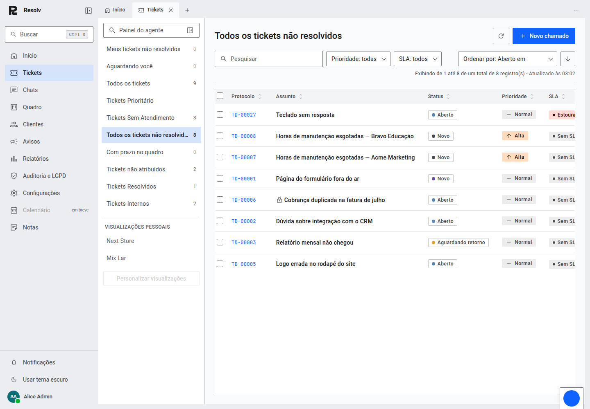
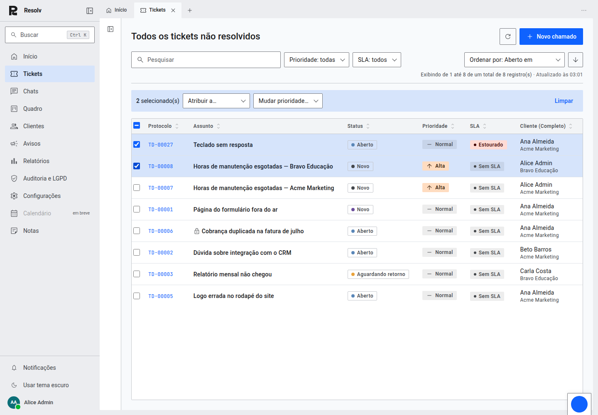
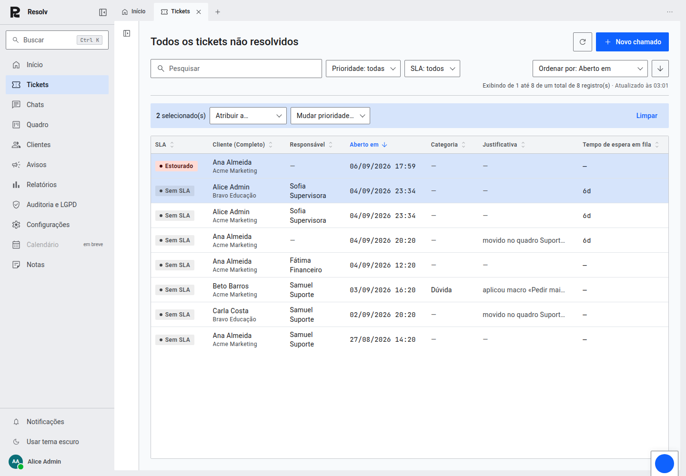
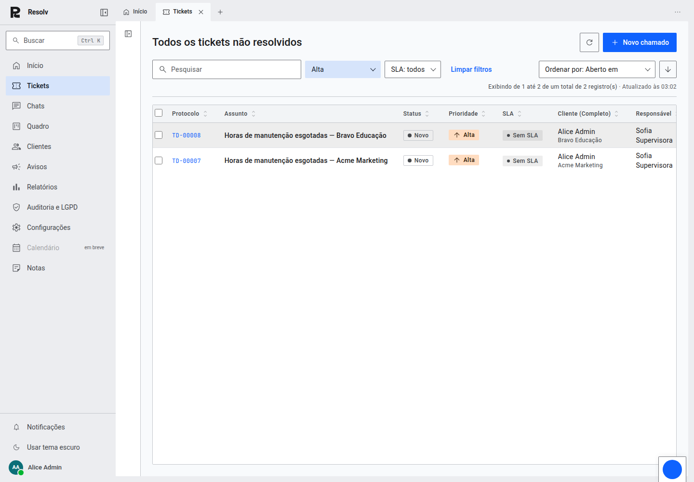
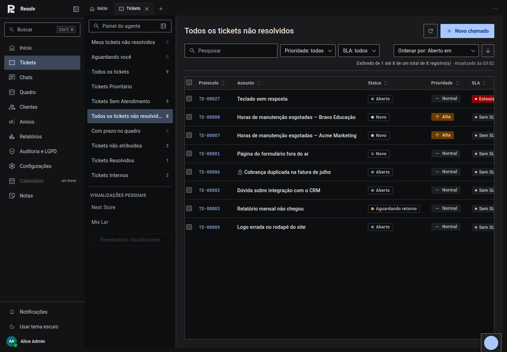
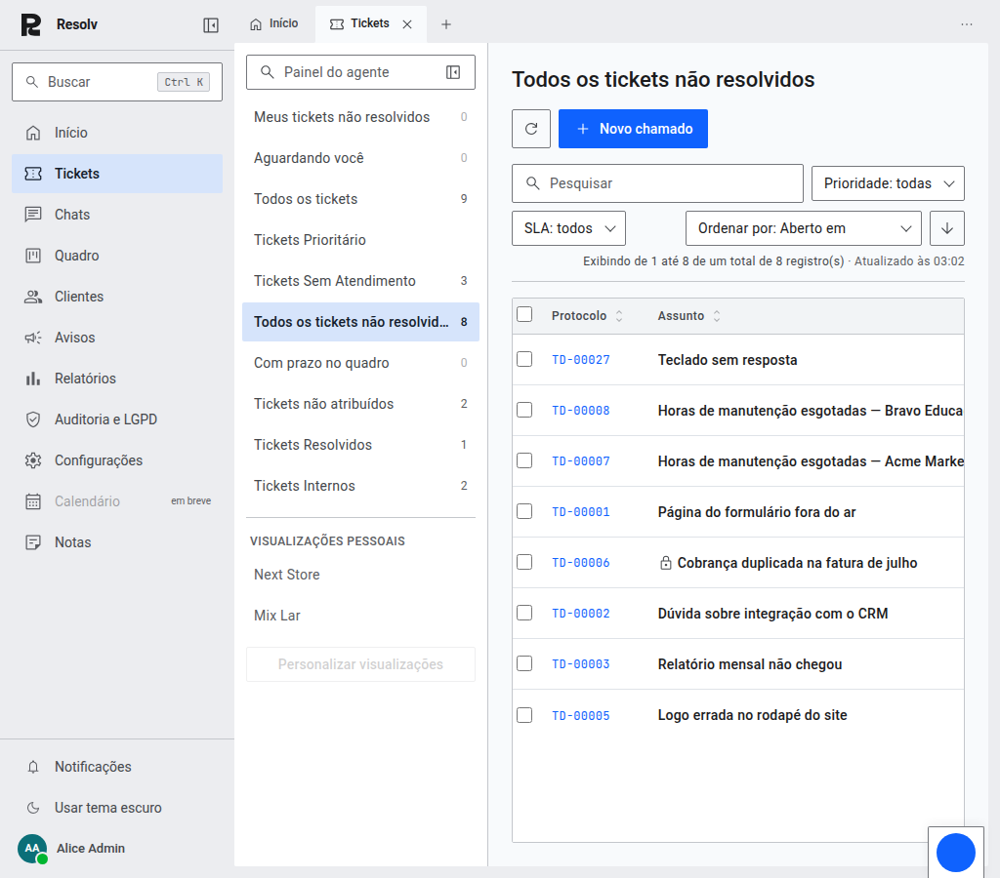
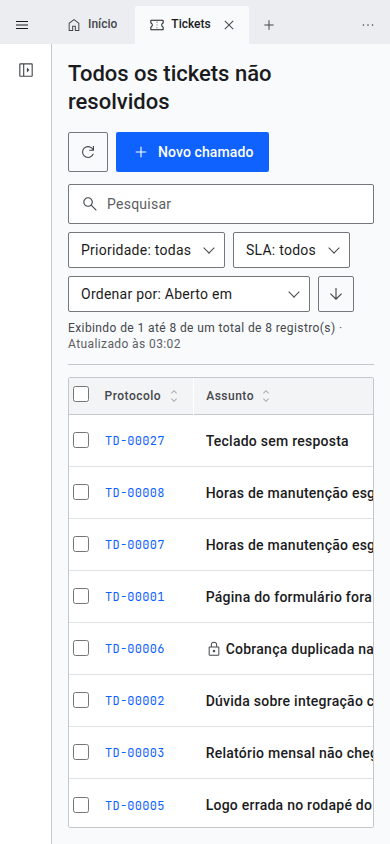

# Listagem de tickets em Material Design 3 — tela 2 de 4

Prints da fila de tickets depois da passagem para o Material Design 3, na
versão compacta da casa. Nenhuma coluna, filtro, ação, rota ou regra saiu;
a mudança é de organização e de leitura.

## O que mudou

**Barra de ferramentas.** Busca, filtros, ordenação e contagem de resultados
passam a viver numa faixa só, acima da tabela — antes a busca estava perdida
no cabeçalho junto das ações e não havia por onde filtrar sem trocar de
visualização.

**Filtros que já existiam no servidor e a fila não acionava.** `priority` e
`sla` são parâmetros que `GET /api/v1/tickets/` sempre aceitou e que só a
Início usava. Agora a tela onde se tria tem os dois. Nada novo no backend.

**Ordenação em dois lugares, um só `?ordering=`.** O clique no cabeçalho
continua igual; o seletor da barra faz o mesmo e torna a ordenação alcançável
no celular, onde o cabeçalho sai da vista com a rolagem horizontal.

**Ordem das colunas por importância.** Protocolo e assunto (quem identifica o
chamado), depois o estado (status, prioridade, SLA — o que decide se atende
agora), depois as pessoas (cliente, responsável) e por último o que se
consulta de vez em quando (data, categoria, justificativa, espera). As onze
colunas continuam lá.

**Cor só onde ela decide.** A prioridade "Normal" era pintada de verde e, como
é a prioridade da maioria dos chamados, a fila inteira ficava colorida e a cor
parava de querer dizer algo. Agora só Alta (âmbar) e Urgente (vermelho) têm
cor; o texto continua dizendo o nome nos quatro casos.

**Linha de 52px, célula com 16px de folga, divisor tênue.** Cabeçalho em
`surface-container-low`, sem borda pesada, com indicador de ordenação discreto.

## Desktop — 1440 × 1000

## Seleção e ação em lote

A "contextual action bar" do M3: as linhas marcadas assumem
`secondary-container` e a barra de ações aparece acima da tabela na mesma cor,
para as duas se lerem como uma coisa só. A caixa do cabeçalho fica
indeterminada quando só parte da página está marcada.

## As demais colunas

A tabela rola na horizontal (nenhuma coluna foi escondida). Aqui o painel de
visualizações está recolhido, que é a largura de quem tria o dia inteiro. Note
o indicador de ordenação na coluna ativa ("Aberto em").

## Filtro aplicado

Filtro ligado assume `secondary-container` — a mesma marca de "selecionado" do
resto da interface — e aparece um "Limpar filtros" ao lado.

## Tema escuro

## Tablet — 1024 × 900

## Celular — 390 × 844

O painel de visualizações já nasce recolhido abaixo de 1024px. A barra de
ferramentas quebra em linhas, a contagem deixa de disputar espaço e as duas
primeiras colunas encolhem para o status entrar na primeira tela.

